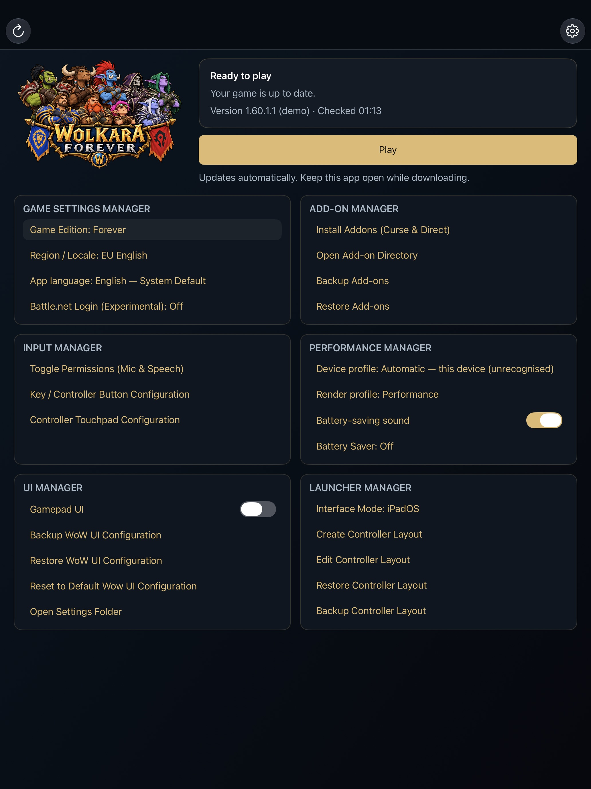

# Use WolkaraForever

> Verified: 2026-11-16 · Source: `9680e63`

Use the launcher to prepare Forever, configure the interface, and recover safely when a setting or add-on causes a problem.

## Set up and update your game

1. On the home screen, select Forever, your region, and the game language.
2. Start the download. The launcher can resume, verify, repair, and update recorded game data.
3. Wait for the ready state before selecting **Play**.

China (`cn`) and Simplified Chinese (`zhCN`) are supported by this local build. China uses
the official China metadata service and its advertised NetEase WoW HTTPS CDN. Fresh China
installs write `portal "CN"` and the selected text/audio locale; changing language alone preserves
the existing login portal and account settings. Updating WolkaraForever under the same bundle ID
keeps the game directory and resumes verified downloaded data. Do not uninstall it to update.

Changing game language can require additional files. App language and game language are separate settings.

Taiwan (`tw`) can be paired with **Traditional Chinese · 繁體中文** (`zhTW`). This choice
survives configuration export/import and is passed to the experimental Battle.net login;
the Taiwan login page opens in Chinese. Game access still depends on the selected account.

For a CN/TW compatibility comparison, install a separately signed Wolkara test app with a
different bundle identifier and its own authorization Keychain group. Its Documents folder,
preferences, and in-app website session are separate from the existing app. Keep the CN app
installed. The current launcher does not isolate two regions within one app's game folder:
changing region there can update that existing installation. Select TW and zhTW in the new
test app before downloading; changing the language alone does not change the regional client.

## Choose how a game starts

The first time you start a game with no mode chosen, the launcher asks how to start it. **Developer service** is the supported route and is what [Install WolkaraForever](INSTALLATION.md) sets up; **Local signing** and **External JIT** need their own setup first. The choice cannot be skipped on that first start, it is remembered afterwards, and the **Execution Mode** button on the library screen changes it. [Build and run WolkaraForever](BUILDING.md) explains what each mode needs.

## Experimental Battle.net Login

In **Game Settings Manager**, open **Battle.net Login (Experimental)**. It is off by default. Enabling it requires acknowledging that it is an experimental compatibility feature, not WolkaraForever's normal login path, and that you use it at your own risk.

When enabled, **Play** completes its usual readiness checks, then opens Battle.net's official sign-in page. Battle.net may hand the browser to your chosen HTTPS identity provider; verify that provider's address before entering credentials. Cancel leaves the game unstarted. A successful result is used once for the immediately following Forever launch. The in-app browser now keeps a dedicated WebKit website session across app restarts. After signing in there once, later launches can obtain a fresh result without copying a Safari address, while the site session remains valid. Battle.net may still require verification. Launch tickets remain single-use. **Disable experimental login** and **Clear sign-in data** remove this saved in-app website session and any pending result. Safari has a separate session, which these controls do not clear.

**Saving the game password.** The same feature can keep one game password on the device, so a launch on a phone does not mean typing it on a phone keyboard. While the game's own password field has the keyboard, a yellow key appears first on the keyboard's row: tapping it reads the password behind Face ID (or the device passcode), types it into that field and presses Return, and holding the key offers to forget it. The first tap offers to save one. The password is a Keychain item on this device only - it is never synchronised, never written to a log or to the game's files, and it is deleted when experimental login is turned off or **Clear sign-in data** is used. The login row says **password saved** while one is kept, and **Sign in with the saved password** in the same sheet starts the game without opening the browser; **Play** still opens Battle.net's sign-in page unless you choose that row.

For China, the browser opens `account.battlenet.com.cn` in Chinese. Existing China selections
from the earlier local build retain browser login on upgrade unless it was explicitly disabled.
For a new setup, enable it in **Game Settings Manager**. Complete login and verification yourself.
To remember login, complete it inside the app once; an existing Safari session is not imported.
If the embedded page cannot finish, choose **Safari fallback…**, open the official page, then paste
its final localhost return address only into the app's masked return field. The app never reads
Safari cookies or the clipboard automatically. Tap **Continue** (or the keyboard's **Done**).
A rejected address shows an alert explaining whether it is empty, incomplete, the wrong page,
or an unsupported result; only that category is logged. Copy the final address again after
correcting the issue. An omitted `http://` is restored only for an explicitly pasted
`localhost:0` return address. Never share the address in chat or logs.
A successful handoff sets the game portal to CN and retains the selected text/audio language.
A manual China callback has been accepted on the physical phone and the Chinese first-run game
page has appeared. The saved embedded session and entry into the game world still need their
own real-device checks; synthetic tests do not prove them. Launcher language remains English,
German or French.

This feature can stop working without notice. Do not include credentials, tickets, callback URLs, or account details in reports.

## Change app language or interface

Open **Settings** to choose an app language. Open **Launcher Manager** to choose **iPadOS** or **iOS on Duo**. Interface selection changes the arrangement only; it does not change game data or add-ons. Automatic on an iPhone, iOS, and iOS on Duo use the same direct-touch gestures when trackpad mode is off: a tap first moves the pointer to the finger, then clicks when the finger lifts. The touch toolbar and host now resolve the same interface setting. This does not change the game resolution or add a fixed tap offset.

## Optional network-health diagnostics

In **Game Settings Manager**, choose **Arm network health for next launch** only when support asks for connection-health evidence. This experimental switch is off by default, is consumed by the next game launch, and stops automatically after 15 minutes. It records anonymous TCP state, latency, buffer and byte counters in the native log; it never records addresses, ports, host names, DNS, payloads, credentials, or game data. Use **Disarm** before starting the game to cancel it.

## Manage add-ons

On the home screen, select **Install Addons (Curse & Direct)** in the **Add-On Manager** card.
The page opens on **My Add-ons** and includes **WolkaraRoue (bundled)** with its own
**Install** or **Update** button. Use that row for the package included in this app;
opening the page does not install anything. You can also view recorded packages,
import a validated archive, or browse a supported provider. An optional provider key
stays in the device Keychain. The app removes only add-ons it recorded as managed.

If an older WolkaraRoue copy was installed outside the manager, this bundled
**Update** action can adopt it. The replacement must contain exactly its existing
folder names; the update journal restores the old folder and ownership state if
the replacement fails. It does not require linking a CurseForge project or removing
the old copy first, and does not replace account SavedVariables.

The bundled touch add-on `WolkaraRoue` now includes Simplified Chinese. Install or
update it from Add-On Manager after leaving the game; updating the launcher alone
does not replace an already installed add-on. Its **Mobile UI → Controls → General
→ Language** selector offers **Follow game**, English, French, Spanish, German and
简体中文. With no saved language choice, a zhCN client automatically uses Chinese;
an explicit supported choice is retained. Save and close the panel to reload the
interface and apply a change. The add-on uses the game's own fonts and its existing
settings migration. Updating its package does not replace game archives or account
SavedVariables. Unsupported game locales fall back to English.
The Chinese menu and shortcut entries use the short labels **法术书** and **地图**,
even when the client supplies longer window titles for those buttons.

To use the existing add-on's default interface, keep **Mobile UI → General →
Layout** on **Standard**. This is a saved layout choice within the current
package, not a different upstream add-on. **Reset positions** restores placement
without removing skills or changing language. `/mobile reset` resets the add-on's
settings and positions while retaining its normal wheel/free-button spells;
on a zhCN client the reset language choice follows the game and remains Chinese.
Choose Standard again if needed, then close the settings panel to save/reload.
The Standard chat panel has its own **X** close button. Only an active Duo chat
pill replaces that button; disabling Duo restores the Standard close action.
If the top Bags, Spells, Map and Menu buttons are absent in Standard, enter
`/mobile`, select **Spell wheels → Shortcuts**, and set it to **On**. In Simplified
Chinese these controls are **技能轮盘 → 快捷按钮 → 开启**. This switch restores the
bar without resetting the layout, assigned spells or language.

Movement comes from the app's on-screen gamepad, separately from the spell wheels.
Expand the bottom toolbar and enable its gamepad button if the movement sticks are
absent. The toolbar gear's **Reset to defaults** restores the native controls'
positions and settings; it does not reset WolkaraRoue or its Chinese language.
The compact jump button below the camera stick has no visible text; its touch
area, binding and accessibility label are unchanged.
For Standard with fixed compact sticks, each Play launch exports the native
controls' actual positions to the installed add-on. The spell wheels clear the
stick hit areas; menus, settings, bags and game windows fit between or above the
controls, with room left for the keyboard toolbar. The export uses a dedicated
add-on data file and does not reset SavedVariables or saved native positions.
After moving or resizing native controls, restart the game to refresh the shared
geometry. Floating sticks and the Duo layout retain their existing arrangements.

Each **Play** launch checks for an attached physical controller after sign-in and
before the game starts. With a controller, WolkaraRoue does not automatically
load and the native keyboard/controls toolbar is off. Without a controller, both
are enabled. Plug in a USB controller or connect Bluetooth before pressing Play;
connecting or disconnecting during a game applies on the next launch. This does
not change **Gamepad UI** or its bindings.

The switch retains the installed Chinese package and all saved wheel positions,
buttons and language choices. It changes only WolkaraRoue's `LoadOnDemand` TOC
field and its rows in existing character `AddOns.txt` files. The TOC also covers
new characters without a saved add-on list. The toolbar choice lasts for this app
process only; stored on-screen control preferences are retained. Other add-ons,
SavedVariables, login settings and game archives are untouched. An absent
WolkaraRoue package is not installed automatically. A preparation error stops
launch so the player can retry after closing the game.

With Chinese selected on a zhCN client, game menu labels use the client's own
localized strings (for example its spellbook, quest log and logout labels), with
Chinese fallbacks if a client version omits a string. Spell/item names already
come from game APIs. The add-on's touch controls have separate translations;
General settings and the General chat channel have separate wording. An explicit
English or other supported language choice does not inherit Chinese game labels.

When an add-on folder includes manifests for several WoW clients, the manager uses the manifest explicitly named for Forever or declaring Forever’s interface to show its title and version. It still considers every manifest when reporting compatibility.

A provider tab without a key shows one **Set up access** row; opening it asks for the key and then loads the tab. When a key is saved, use the **⚙️** button in the Add-on Manager’s top bar to **Change CurseForge key…** or **Remove key**; removal is confirmed and leaves the key only deleted from this device's Keychain. Each installed row shows the package's name, version, author and its CurseForge thumbnail once the package records a provider identity, and one word about its update with the action that goes with it: **Update**, **Check**, **Retry**, **Open**, **Link** or **Manage**. **Not checked yet** means nothing has asked the provider about that package yet, and **Check** is what asks; **Update** asks anyway and either installs the newest file or reports that the package is current. **Update All** runs the same question for every eligible package and finishes when each one has been written, so rows settle together rather than returning to **Not checked yet**.

## Back up or recover your interface

Use **UI Manager** before large interface changes. **Gamepad UI** is first; its state is written to the active Forever `Config.wtf`. Create a backup before restoring a selected backup if the interface becomes unusable. **Reset to Default Wow UI Configuration** resets only graphics and display settings. Recovery does not replace the game installation.

## Save battery while you play

Open **Performance Manager → Battery Saver**. Both choices there apply the next time you start the game: a setting that took effect mid-session would change the pacing under your hands, so the row's summary is what the next launch will use and changing it never disturbs a game that is already running. Nothing in this menu edits the game's own settings.

**Frame limit** is **Off** by default. **Automatic** is 60 frames per second on power and 30 on battery; **30 FPS** and **60 FPS** are fixed rates. iPadOS's Low Power Mode, or a device that is running hot, lowers any cap to 30 FPS. The cap is applied to the presentation of the frames the game already renders, so it costs nothing when it is Off.

**AFK saver** is **Off** by default. After the chosen time without input the screen dims and the game is held at 10 FPS. The first touch, key, mouse action or controller action only wakes it — it is not delivered to the game, so reaching for the tablet does not also move the camera or fire a spell. Dimming pauses whenever something is being held, whenever the in-game touch configuration is open, and whenever WolkaraForever is not in front. It never changes screen brightness, the device's auto-lock, the session or the game's files.

The performance overlay is not switched on from the launcher. Open it while the game runs, from the in-game settings page next to the touch toolbar, where you can also see the frame rate the game is actually presenting.

## Configure controls and voice

Use the touch toolbar, trackpad, keyboard, gamepad, physical keyboard, or controller that fits your device. For dictation, open voice configuration, grant permission, select a trigger and Hold or Toggle behavior, then use **Test Voice** before dictating into a text field. Enabling dictation establishes the game's duplex audio route before a controller hold; the hold and release themselves do not change the audio category or remove the game output route. Leaving the app stops an open dictation capture, but does not add a WolkaraForever frame cap to the running guest.

A DualSense or DualShock 4 touchpad can move the game's pointer. In **Input Manager**, open **Controller Touchpad Configuration**. It is off until you turn it on and is saved on the iPad. One finger moves the pointer and two fingers scroll. Pressing the touchpad is the left mouse button, or the right button with two fingers on the pad, and pressing while you slide drags. Tapping without pressing does nothing, so a thumb resting on the pad does not click. The controller touchpad and a physical mouse or trackpad hand off when the controller contact ends; iPadOS's duplicate mouse stream for the controller surface is ignored while that contact or click is active. The page offers Slow, Normal and Fast speeds plus a live controller-touchpad test showing the reported finger count and coordinates. While this is on, the touchpad click is the mouse button only and cannot be chosen as a dictation trigger. The dictation test is inside **Key / Controller Button Configuration**. A DualSense Edge connected over Bluetooth can omit touchpad reports on iPadOS; use its USB-C connection when the live test remains empty.

## Battery-saving sound

**Battery-saving sound** in **Performance Manager** is on by default, in every interface mode. The game's sound plays as before, without loading iOS's audio device layer into the game, whose Bluetooth part kept a quarter of a processor core busy for the whole game. If the sound ever misbehaves (silence, crackles, or no sound after you connect headphones), turn it off; the change applies from the next game start.

If a phone call interrupts Forever, returning to the game restores its active audio session when iPadOS says playback may resume. If sound does not return, keep the app installed and send its log rather than reinstalling; [Send us a log](SENDING_LOGS.md) explains how.

## Get help safely

When something fails, send a log — it is three taps and needs no computer:
[Send us a log](SENDING_LOGS.md) shows where **Settings → Diagnostics and logs → Logs and
reports** is, which file to pick, and how to share it.

If a failure offers **Technical details** in the Settings sheet, copy that message too: it is
the exact reason, and it matches a line in the log. Do not share credentials, pairing data,
signing information, account information, or device identifiers, and do not delete the app
as a first troubleshooting step — the log you need goes with it.

### Memory permission diagnostics

For a runtime permission failure, a private build with `WOLKARA_HOST_DIAGNOSTICS=1`
also records bounded mapping provenance. Alternatively launch the normal shell with
`--memory-permission-diagnostics`, then press Play yourself. The runtime retains the
last 512 mapping operations and reports at most 64 executable or non-null hinted requests plus eight
failures, with requested permissions, API results, and caller image identifiers.
An unknown origin means the mapping was not retained or its range changed; it is not
evidence that no allocation occurred. Only API arguments and existing loader metadata
are used; no application bytes, stack frames, credentials, or gameplay are inspected.
The diagnostics preserve API results and errno. They do not enable JIT or claim to
fix a client crash. Read the runtime log with `wolkaraforever/tools/device_log.sh`.

The explicit `--local-code-swap-probe` diagnostic prepares two pages before any
game entry, runs only our return-value functions, and tests replacing a writable
view then restoring an executable view at the **originally prepared address**.
It is separate from `--local-code-remap-probe`, which tries a new address. Neither
path is enabled for the game. A Mac pass is not evidence of device execution.

Ordinary anonymous mappings now honor an address as a hint: a hint inside the
loaded image no longer clears or changes the protection of existing image pages.
The existing explicit fixed-map and MAP_JIT image-rewrite adapters are retained.
This corrects mapping ownership; it does not itself grant execution permission to
new dynamic code on iPhone. Memory diagnostics distinguish the requested hint
from the returned allocation address.

The same private diagnostics attribute a `CFRetain(NULL)` call to its loaded image
and caller offset before forwarding it unchanged. They do not turn a missing
object into a valid object, suppress the system trap, or inspect object contents
or stacks. This distinguishes an initial CoreFoundation failure from a later
watchdog termination while the application writes its own crash report.

Local AppKit event monitors now register on ordinary launches. The adapter uses
its existing in-process event dispatcher and returns a real removable token for
a valid handler; it no longer returns nil just because `--appkit-event-monitors`
was absent. Matching callbacks may pass, replace or consume an event. Global
monitoring of other applications remains unavailable on iOS. Registration logs
are capped at eight per API and contain only handler/token availability. A unit
test of monitor ownership does not establish client stability on a device.
